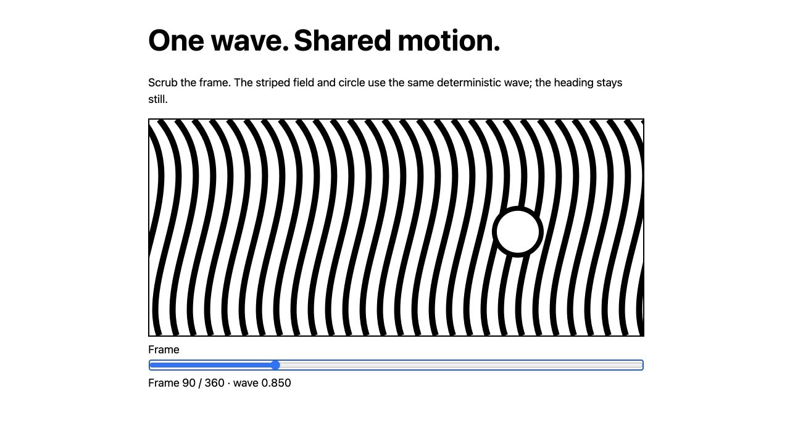

# 001 — Frame-driven loops

An animation should produce the same pose whenever the renderer asks for the same frame. Time therefore comes from the frame number and composition fps.

`loopPhase(frame, fps, seconds)` wraps the frame into one cycle. `loopWave(phase)` blends a fundamental sine with a smaller second harmonic. Multiple elements can consume this same wave with different amplitudes, giving them a shared rhythm.

In a Remotion composition:

```jsx
import {useCurrentFrame, useVideoConfig} from "remotion";
import {loopPhase, loopWave} from "./loop.mjs";

const frame = useCurrentFrame();
const {fps} = useVideoConfig();
const wave = loopWave(loopPhase(frame, fps, 12));
// Use wave to drive an authored parameter; keep reading text stationary.
```

For a 12-second loop at 30 fps, render frames 0 through 359. Frame 360 is the conceptual next cycle's frame 0, not an extra export frame. A matching endpoint does not prove a smooth visual seam: rendered pixels and velocity must also be checked.

The browser demo is a deterministic frame scrubber, not a video export. It intentionally avoids browser-clock playback. It uses neutral vector lines rather than private studio artwork.

Limitations: this helper supplies timing, not a displacement shader or a complete composition. Choose an integer frame count for delivery; arbitrary non-integer periods may not line up with a frame boundary.


